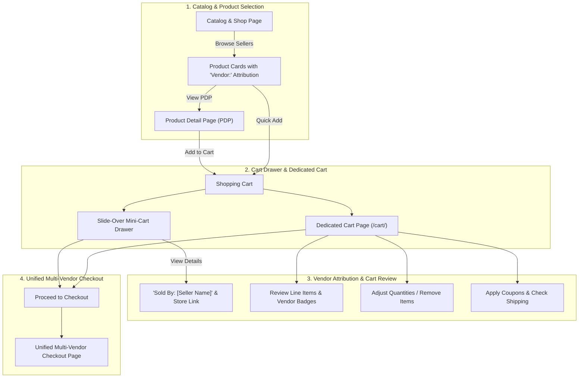

# Multi-Vendor Cart

The **Multi-Vendor Cart** is a central shopping feature of the **WooCommerce Multi-Vendor Marketplace**. It allows buyers to add items from multiple independent sellers into a single shopping cart and complete their order in one smooth, unified checkout.

In a traditional online store, all products belong to one merchant. In a multi-vendor marketplace, items come from different shops, each with its own inventory, fulfillment timeline, and store policies. The Multi-Vendor Cart brings total transparency to this process by clearly showing **who sells each item**, providing **direct vendor store links**, and calculating totals accurately before the buyer proceeds to payment.

---

## How the Multi-Vendor Cart Journey Works

The following workflow diagram illustrates the entire customer shopping flow from product discovery through multi-vendor cart management to unified checkout:

---

## 1. Product Discovery & Adding Multi-Vendor Items

Before items arrive in the cart, customers can easily find and identify products belonging to specific marketplace sellers:

### Seller List Filter on the Catalog Page
On the main shop and category listing pages, buyers can use the **Seller List** filter in the sidebar to browse items from individual merchants:
- **Expandable Seller Accordion**: Click the **Seller List** header to expand the full directory of active sellers.
- **Product Count Badges**: Each seller name displays the total number of products they currently list (for example, *Aurora Athletics (14)*, *Copperleaf Kitchen (10)*, *Volt & Vine (9)*).
- **Multi-Select Filtering**: Customers can select one or more seller checkboxes to immediately filter the catalog.
- **Clear Filters Button**: A quick-reset button appears as soon as a filter is applied, allowing shoppers to return to the full catalog with a single click.

### Vendor Attribution on Product Cards
Every product card across the storefront clearly identifies the selling merchant:
- A blue **Vendor: [Seller Name]** tag appears directly above or below the product title.
- Clicking the vendor name opens that seller's dedicated marketplace storefront.
- When customers click **Add to Cart**, the item is added to their cart with that seller's metadata securely attached.

---

## 2. Slide-Over Mini-Cart Drawer

Customers do not need to leave their current shopping page to check their cart contents. The marketplace header includes an interactive **Mini-Cart Drawer**:

### Key Mini-Cart Features:
1. **Header Cart Icon & Badge**: Displays the total count of items currently in the cart.
2. **Instant Slide-Out Drawer**: Clicking the cart button smoothly opens a side panel from the right edge of the screen.
3. **Item Overview**: Displays the product thumbnail, item name, unit price, and a quick quantity selector.
4. **"See Details" Expandable Toggle**:
   - Each item in the drawer features a **See Details** link.
   - Clicking **See Details** reveals the **`Sold By : [Vendor Name]`** attribution.
   - The vendor name links directly to the vendor's profile in a new tab so buyers can review seller ratings and policies without losing their place.
5. **Quantity & Removal Controls**: Customers can adjust item quantities (`+` or `-`) or click the trash can icon to remove an item immediately.
6. **Subtotal & Fast Action Buttons**: Displays the live cart subtotal alongside direct buttons for **View Cart** and **Proceed to Checkout**.

---

## 3. Dedicated Multi-Vendor Cart Page

Navigating to `/cart/` opens the full cart page. Powered by modern WooCommerce Cart Blocks, this page provides a clean, responsive layout optimized for multi-seller transactions:

### Line Item Breakdown & Vendor Attribution

Each row in the cart table provides comprehensive item details:

| Element | Description | Customer Advantage |
| :--- | :--- | :--- |
| **Product Image & Title** | Clear photo and clickable product link | Quick verification of ordered products |
| **Price & Discount Badges** | Shows regular price struck through with the discounted sale price and a green **Save $X.XX** badge | Immediate visibility into promotional marketplace savings |
| **Short Description** | A brief summary of key product specifications | Ensures correct selection before ordering |
| **Sold By Attribution** | Bold `Sold By : [Vendor Name]` label with a link opening the vendor store in a new tab | Complete seller transparency; builds customer confidence |
| **Interactive Quantity Stepper** | Stepper with `−` and `+` buttons and manual number input bounded by live seller inventory | Adjust quantities instantly without manual page refreshes |
| **Remove Button** | A trash icon button next to each item | One-click removal with immediate total recalculation |

::: tip Vendor Verification
Always verify the **Sold By** name if you are purchasing multiple complementary products (for example, accessories or matching items). Buying from the same vendor often combines packaging and simplifies shipping timelines.
:::

---

## 4. Quantity Adjustments & Real-Time Updates

Managing quantities in the Multi-Vendor Cart is fast and intuitive:

1. **Increasing Quantity**: Click the `+` button. The cart automatically recalculates the item total and the order subtotal via AJAX.
2. **Decreasing Quantity**: Click the `−` button. If the quantity reaches 1, the minus button disables to prevent accidental zeroing.
3. **Stock Ceiling**: The stepper automatically respects the maximum stock currently available from that specific vendor.
4. **Instant Total Recalculation**: Customers do not need to search for an "Update Cart" button—all line totals, shipping options, and estimated order totals update automatically.

---

## 5. Order Summary, Coupons & Shipping

The right-hand side of the cart page displays the **Order Summary** block:

### 1. Unified Subtotal
The subtotal aggregates all products across all sellers into one unified dollar amount. Customers pay once regardless of how many vendors are represented in the cart.

### 2. Promo & Coupon Code Drawer
- Customers can click the **Add coupons** toggle to reveal the coupon input field.
- Enter a valid coupon code and click **Apply**.
- If a vendor-specific or store-wide coupon is used, the discount automatically applies to qualifying items and reflects in the order summary.

### 3. Shipping Calculation
- Displays available shipping methods (such as **Free shipping** or **Flat rate**).
- When vendors have independent shipping configurations or rates, the cart aggregates the applicable delivery options for customer selection.

### 4. Estimated Total & Checkout Button
- Clearly lists taxes (if applicable), discounts, shipping fees, and the final estimated total.
- The prominent **Proceed to Checkout** button directs the customer to the secure checkout page.

---

## 6. Empty Cart Experience

If a customer removes all items or visits the cart before adding products, the cart displays a helpful empty state:

- A clear notification states: **"Your cart is currently empty!"**.
- Helpful marketplace category shortcuts or a direct link to return to the shop allow customers to quickly resume browsing.

---

## 7. Transition from Cart to Checkout

When the customer clicks **Proceed to Checkout**, all multi-vendor products carry over smoothly into the Checkout block:

### Continuous Seller Visibility
In the Checkout **Order summary** panel:
- Each product line item retains its distinct **`Sold By : [Vendor Name]`** attribution.
- Original and discounted pricing remains clear.
- Customers enter their billing and shipping details once, select their preferred payment gateway, and complete the order.

### Behind the Scenes: Split Order Processing
Once the order is placed:
- The customer receives a single consolidated order confirmation and receipt.
- The marketplace backend automatically divides the order into separate vendor-specific sub-orders.
- Each seller receives a notification in their vendor dashboard containing only their items, allowing them to package and ship goods independently.

---

## Comparison: Standard WooCommerce Cart vs Multi-Vendor Cart

| Feature | Standard Single-Store Cart | WooCommerce Multi-Vendor Cart |
| :--- | :--- | :--- |
| **Seller Transparency** | Not present (all items come from the site owner) | Prominent `Sold By : [Seller Name]` with direct store links |
| **Catalog Source** | Single merchant catalog | Multiple independent merchants |
| **Drawer Mini-Cart** | Generic product list | Includes expandable "See Details" with vendor attribution |
| **Stock Management** | Single warehouse / store inventory | Independent vendor-managed inventory per item |
| **Checkout Flow** | Standard single order | Single customer payment with automatic seller sub-orders |
| **Fulfillment** | Single shipment source | Independent shipping and fulfillment by each vendor |

---

## Frequently Asked Questions (FAQ)

### Can I purchase products from different vendors in a single order?
**Yes.** The Multi-Vendor Cart is specifically designed to allow customers to mix and match items from any number of marketplace sellers. You only need to enter payment details once during checkout.

### How do I know which vendor sells a product in my cart?
Every product row on the cart page displays a `Sold By : [Vendor Name]` label directly under the product description. In the slide-over mini-cart drawer, click **See Details** under any product to view its seller.

### What happens if I click on the seller's name in the cart?
Clicking the vendor's name opens their dedicated store page in a new browser tab. You can view all other products offered by that seller, check their overall ratings, or read their store policies without losing items in your cart.

### Will products from different sellers arrive in the same package?
Because marketplace sellers operate from different locations and manage their own inventory, items ordered from different vendors are typically packaged and shipped separately. You will receive tracking details for each package as vendors dispatch them.

### Can I apply coupons in the multi-vendor cart?
**Yes.** You can expand the **Add coupons** section in the Order Summary to apply eligible discount codes. The cart will automatically calculate and apply discounts to the corresponding products.
