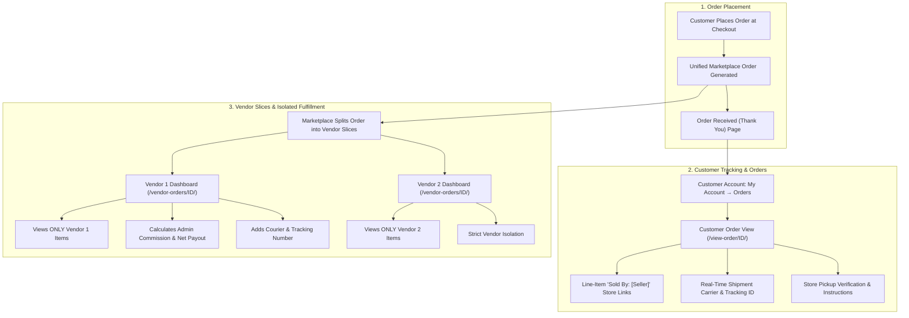

# Order Details & Seller Visibility

In a multi-vendor marketplace, a single customer order frequently contains products fulfilled by different independent merchants. Ensuring clear **Order Details & Seller Visibility** is essential for building buyer trust, reducing support inquiries, and maintaining smooth fulfillment operations.

The **WooCommerce Multi-Vendor Marketplace** provides end-to-end transparency:
- **For Customers**: Every order clearly identifies **who sells each item**, provides direct links to the merchant's storefront, and displays real-time carrier tracking information and store pickup updates.
- **For Vendors**: Each seller receives a private, secure view of **only their portion of the order**, showing their sold items, calculated marketplace commission, net earnings, and tools to update statuses, add shipments, issue refunds, and print invoices.

---

## Order Visibility & Fulfillment Architecture

The diagram below illustrates how an order moves from initial placement through customer tracking and isolated vendor fulfillment:

---

## 1. Order Confirmation (Order Received Page)

Immediately after completing checkout, the customer lands on the **Order Received** (Thank You) confirmation screen. This page provides immediate reassurance and details every vendor involved in the purchase.

### Key Information Displayed:
1. **Order Identification Banner**:
   - Displays the permanent Order ID (e.g., `Your Order no. is #1192`).
   - Friendly greeting confirming receipt of the purchase.
2. **Order Metadata Grid**:
   - **Customer Email**: Billing and contact email registered to the order.
   - **Payment Method**: Displays the payment option chosen (e.g., *Direct bank transfer*, *Cash on delivery*, *Credit Card*).
   - **Order Date & Time**: Timestamp when the order was placed.
   - **Total Amount**: Final paid or due amount including taxes and shipping.
3. **Line-Item Vendor Attribution**:
   - **SKU**: Specific product identification code (e.g., `XL-ELE-05`, `XL-BEA-14`).
   - **Product Name**: Direct clickable link back to the product detail page.
   - **Sold By Badge**: Clear attribution label indicating the merchant responsible for fulfilling that item (e.g., **`Sold By: Aurora Athletics`**). Clicking the seller name opens the vendor's storefront profile.
   - **Unit Price & Quantity**: Clear item pricing and ordered quantity (`× 1`, `× 2`).
   - **Line Total**: Calculated line item amount.
4. **Totals & Address Blocks**:
   - Subtotal, selected shipping method, and full billing/shipping destination addresses.
   - **Return to Shop Button**: Convenient navigation link to return to the marketplace catalog.

---

## 2. Customer Order History (`My Account → Orders`)

Customers can review and track all current and historical orders at any time from their personal marketplace account dashboard.

### How Customers Access Their Orders:
1. Log in to the marketplace using the header **Account** link.
2. Navigate to **My Account → Orders** in the sidebar navigation menu.
3. View the responsive **Orders Table**, which organizes purchases with the following details:

| Column | Information Provided |
| :--- | :--- |
| **Order** | Unique order number prefixed with `#` (e.g., `#1171`, `#1170`, `#1169`). |
| **Date** | Date and time the customer placed the order. |
| **Status** | Current processing state (e.g., `Processing`, `On hold`, `Completed`, `Cancelled`). |
| **Total** | Total order amount and the total count of purchased items (e.g., `$258.00 for 2 items`). |
| **Actions** | Direct **View** button to inspect complete order details, vendor stores, and tracking notes. |

---

## 3. Detailed Customer Order View (`/view-order/[id]/`)

Clicking the **View** button on any order opens the full **Order Details** screen. This page serves as the customer's central hub for delivery updates, vendor attribution, and store pickup management.

### 1. Order Header & Status Badge
- Displays the order number and formatted creation date.
- Highlights the current operational status with a clear badge (`Processing`, `On hold`, or `Completed`).

### 2. Live Order Updates & Shipment Tracking
When a seller dispatches an item or schedules a delivery, a dedicated **Order Updates** card appears automatically above the product table:

- **Fulfillment Status Notice**: Informs the customer about the fulfillment stage (for example: *"Your items from Aurora Athletics are scheduled for pickup / in transit"*).
- **Carrier Name & Title**: Identifies the exact logistics carrier or service handling delivery (e.g., *Fulfilment Carriers – Standard Express*, *FedEx*, *UPS*, *DHL*).
- **Tracking ID / Number**: Provides the exact tracking reference number (e.g., `Tracking ID: 2222`) that the customer can use to follow shipment progress.
- **Fulfilled Items Breakdown**: Lists which items from the order are contained in that specific shipment package.

### 3. Store Pickup & Local Collection Details
If the customer selected local store pickup during checkout:
- Displays the vendor store location (e.g., `Aurora Athletics · 1420 SE Water Avenue, Suite 3, Portland, OR 97214`).
- Shows the merchant's contact phone number with a direct click-to-call link (`tel:+15035550102`).
- Details specific collection instructions and store operating hours (e.g., *Collect at store desk*).
- Shows pickup readiness status (`Ready to Pickup`).

### 4. Line Items Table & Merchant Links
- **SKU & Product Name**: Clickable links leading back to individual product detail pages.
- **Sold By Attribution**: Prominently highlights the selling merchant for each line item. Clicking the vendor name opens their seller profile in a new tab, allowing buyers to verify seller policies or review other store offerings.
- **Quantity & Line Totals**: Explicit breakdown of individual item costs.

### 5. Order Actions & Reordering
- For completed or existing purchases, an **Order Again** button allows customers to reload identical items into their cart with one click for effortless repurchase.

---

## 4. Vendor Order Visibility & Security Isolation

A multi-vendor marketplace requires strict data isolation. Sellers should only see information relevant to the products they fulfill. The marketplace enforces automatic multi-tenant partitioning across all order views.

### Multi-Tenant Security & Access Control

When multiple sellers receive items within the same customer order, each vendor is granted access **strictly to their own portion**:

::: tip Strict Data Protection
- **No Cross-Vendor Data Leaks**: A vendor cannot view products sold by other merchants, other merchants' customer messages, or other merchants' revenue shares.
- **Unauthorized Access Prevention**: If a merchant attempts to open an order that does not contain their products, the platform displays an access restriction message (*"Sorry, You can't access other vendor's orders"*).
:::

---

## 5. Vendor Order Management (`Vendor Dashboard → Order History`)

When a vendor navigates to **My Account → Order History** (or `/my-account/vendor-orders/`), they access a dedicated management workspace tailored specifically to their store's fulfillment duties.

### 1. Vendor Financial Breakdown & Commission Transparency
The vendor order details card provides transparent financial accounting for that specific order slice:

- **Product Subtotal**: The total gross sales amount generated by the vendor's items in the order.
- **Admin Commission**: The marketplace fee automatically calculated according to admin commission rules.
- **Total (Net Vendor Earning)**: The exact payout amount credited to the vendor after commission deductions (e.g., Subtotal: `$360.00` − Admin Commission: `$43.20` = Vendor Net Total: `$316.80`).
- **Payment Method**: Indicates whether the customer paid via online gateway, cash on delivery, or direct transfer.

### 2. Customer Contact & Delivery Details
Vendors receive the necessary shipping and contact information to fulfill items promptly:
- **Customer Email**: Direct clickable `mailto:` link for order queries.
- **Telephone**: Click-to-call telephone link for urgent delivery coordination.
- **Billing & Shipping Addresses**: Formatted delivery destinations.

### 3. Order Status Controls
Vendors can independently manage their fulfillment lifecycle:
- Status options include `Pending payment`, `Processing`, `On hold`, `Completed`, `Cancelled`, and `Refunded`.
- Updating the status to **Completed** notifies the customer and updates delivery milestones.

### 4. Shipment Creation & Tracking Entry
- Vendors can attach fulfillment carriers and enter **Tracking Numbers**.
- Once saved, tracking details immediately publish to the customer's **Order Updates** section and trigger shipment notification emails.

### 5. Line-Item Refunds & Restocking
- Vendors can process manual or payment gateway refunds directly from the order view.
- Supports partial refunds on individual line items or full refunds.
- Includes an option to automatically **Restock Refunded Items** in the vendor's inventory.

### 6. Print Vendor Invoices
- Clicking **Print Invoice** generates a clean, printable PDF-ready invoice displaying only the vendor's products, tax breakdown, and store branding.

---

## Customer View vs. Vendor View: Feature Comparison

The table below contrasts what information is accessible to the buyer versus the selling vendor:

| Information / Feature | Customer View (`/my-account/view-order/`) | Vendor View (`/my-account/vendor-orders/`) |
| :--- | :--- | :--- |
| **All Order Items** | Yes (sees items from all vendors in the order) | No (sees only products belonging to their store) |
| **Vendor Attribution (`Sold By`)** | Yes (prominent name with store profile link) | Yes (confirms seller brand identity) |
| **Carrier & Tracking Number** | Yes (visible in real-time Order Updates) | Yes (editable input to add courier & tracking code) |
| **Store Pickup Details** | Yes (pickup address, desk instructions, hours) | Yes (pickup verification code & customer check-in) |
| **Admin Commission Breakdown** | No (hidden from customer view) | Yes (shows fee deduction and net seller earnings) |
| **Competitor / Other Sellers' Data** | Visible only as public product listings in cart | Zero access (strictly isolated by vendor security) |
| **Order Status Updates** | Read-only status badge | Actionable dropdown to advance fulfillment status |
| **Print Invoice** | Standard customer order receipt | Vendor-branded itemized invoice |
| **Refund Request / Management** | Initiates refund query through seller support | Controls line-item refund totals and restocks |
| **Reorder Button (`Order Again`)** | Yes (one-click cart repurchase) | Not applicable |

---

## Best Practices for Customers and Vendors

### For Customers:
- **Check Vendor Profiles Before Inquiring**: Clicking the **Sold By** link on any order item takes you directly to that vendor's storefront, where you can find store policies, average ratings, and direct contact options.
- **Monitor the Order Updates Box**: Once your package is dispatched, check your order page for the **Carrier Name** and **Tracking ID** to track delivery transit in real time.
- **Keep Verification Codes Ready for Store Pickup**: If you selected local pickup, ensure you have your pickup notification or order confirmation handy when visiting the store desk.

### For Vendors:
- **Add Tracking Promptly**: Enter carrier titles and tracking IDs as soon as orders are handed over to couriers to keep buyers informed and avoid support tickets.
- **Keep Order Statuses Updated**: Transition orders from *Processing* to *Completed* once delivery is confirmed to maintain an accurate seller account health score.
- **Review Commission Deductions**: Regularly audit the commission line item on each order to reconcile your net payouts with marketplace payout statements.

---

## Frequently Asked Questions (FAQ)

### Can a customer order from multiple sellers in a single checkout?
Yes. The WooCommerce Multi-Vendor Marketplace supports multi-vendor carts. Customers can add items from different sellers and complete a single checkout transaction. The order confirmation and order details pages display clear `Sold By: [Seller Name]` tags for each item.

### Can a seller see the entire customer order if it includes other vendors' items?
No. For privacy, security, and competitive reasons, each seller can only view their own products, their own line-item totals, and their own calculated commission. Sellers cannot view products or revenue belonging to other merchants.

### How does a customer track their package?
When a vendor dispatches an order and adds shipment information, an **Order Updates** section appears on the customer's order view page (`My Account → Orders → View`). This section details the carrier name, carrier title, and tracking ID.

### Where can a customer find store pickup details?
If store pickup was chosen during checkout, the order details page displays the designated store address, store phone number, operating hours, and pickup desk instructions beneath the corresponding product.

### How does a vendor print an invoice for an order?
Vendors can open the order from **Vendor Dashboard → Order History**, click on the order number, and select the **Print Invoice** button at the top of the order details card. The invoice will only list items sold by that vendor.

---

## Related Documentation

- [Multi-Vendor Cart Customer Guide](https://wpdoc.webkul.com/woocommerce-marketplace/documentation/customer-multi-vendor-cart.html)
- [Product Detail Page (PDP) Customer Guide](https://wpdoc.webkul.com/woocommerce-marketplace/documentation/customer-pdp.html)
- [Customer Order Placement](https://wpdoc.webkul.com/woocommerce-marketplace/documentation/customer-order-placement.html)
- [Vendor Order Management Guide](https://wpdoc.webkul.com/woocommerce-marketplace/documentation/vendor-order-management.html)
- [Vendor Invoice Configuration](https://wpdoc.webkul.com/woocommerce-marketplace/documentation/configuration-vendor-invoice.html)
