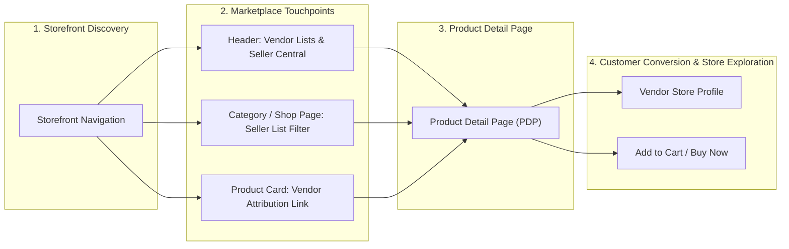

# Product Detail Page (PDP)

The **Product Detail Page (PDP)** is the main page where buyers explore individual items, review vendor information, select product options, and make a purchase in the **WooCommerce Multi-Vendor Marketplace**.

Unlike a standard single-store shop, a multi-vendor marketplace connects customers with multiple independent sellers. The PDP gives customers full transparency by showing **who sells the product**, **how other buyers rate it**, and **how to report a listing** if there is an issue.

---

## Customer Discovery: How Buyers Find Vendor Products

Customers can discover vendor products through several marketplace touchpoints before reaching the Product Detail Page:

### 1. Header Navigation & Marketplace Menus

The marketplace storefront header provides dedicated navigation links for buyer-to-seller discovery:

- **Vendor Lists Menu**: A top navigation menu item with an interactive dropdown. Customers can view active marketplace sellers (for example, *Volt & Vine*, *Aurora Athletics*, *Maison Terra*) and click any seller name to visit their dedicated storefront.
- **Seller Central / Sell on Marketplace**: A direct header link for prospective sellers to learn about onboarding, commission rates, and registration.
- **Customer Account**: Quick access for buyers to manage orders, wishlists, and vendor communications.

---

### 2. Seller List Filter on Category & Listing Pages

When browsing shop archives or categories (such as *Electronics*, *Home & Living*, or *Accessories*), customers can narrow down items by specific vendors:

- **Seller List Accordion**: Located in the sidebar filter area. Clicking the header expands the list of active marketplace sellers.
- **Product Count Badges**: Each seller name shows the number of available products in that category (for example, *Volt & Vine (7)*, *Aurora Athletics (2)*).
- **Instant Filtering**: Selecting a seller checkbox refreshes the product catalog to show only products sold by that merchant.
- **Clear Filters Button**: A convenient reset button appears as soon as a filter is applied, allowing buyers to return to the full catalog with one click.

---

### 3. Vendor Attribution on Product Cards

Every product card on listing pages clearly displays vendor information before the customer clicks through:

- **Vendor Name Link**: Labeled as `Vendor: [Vendor Name]` in a distinctive royal blue color. Clicking the vendor name opens the seller's profile page.
- **Add to Cart Tooltip**: Hovering over the cart button shows `Sold By: [Vendor Name]`, confirming the seller identity.
- **Quick Action Buttons**: Includes quick wishlist saving and product comparison alongside direct cart addition.

---

## Key Elements on the Product Detail Page (PDP)

Once a customer clicks on a product, the Product Detail Page provides all the information needed to evaluate and purchase the item.

### 1. Vendor Attribution & Store Link

Prominently located directly beneath the product title:

- Displays `Vendor:` followed by the seller's business name (e.g., **Volt & Vine**).
- The vendor name is a clickable link. Clicking it takes the buyer directly to the seller's storefront where they can view all items, store policies, and seller ratings.
- Transparent attribution builds buyer confidence and trust in multi-seller transactions.

### 2. Ratings & Review Summary

- Displays the average star rating (e.g., `4.5 Stars`).
- Displays total customer reviews (e.g., `(2 Reviews)`).
- Clicking the review count smoothly scrolls the page to the **Customer Reviews** section.

### 3. Pricing & Variants

- **Clear Pricing**: Displays standard pricing or discounted sale pricing with promotional badges.
- **Price Ranges**: For variable products with different options, displays the lowest to highest price range (e.g., `$189.00 – $201.00`).
- **Product Options**: Customers can select specific variations such as color, size, or material. When a variation is selected, the price, SKU, and stock count update in real time.

### 4. Live Stock Availability

- Real-time stock status badge displays whether the item is `IN STOCK` or out of stock.
- Shows remaining units (e.g., `36 in stock`), helping customers make timely purchasing decisions.

### 5. Short Description & Origin

- Summarizes key product features and materials.
- Highlights vendor craftsmanship details (e.g., *"Made in small batches by Volt & Vine in Austin, TX"*).

### 6. Purchasing Actions

- **Quantity Selector**: Buyers can select desired units using increment/decrement controls or direct input.
- **Add to Cart**: Adds the selected product to the buyer's cart while preserving vendor metadata for multi-vendor checkout.
- **Buy Now**: Bypasses the cart page and takes the buyer straight to checkout for instant purchasing.
- **Social Sharing**: Quick sharing icons for Facebook, Twitter/X, Pinterest, and LinkedIn.

---

## Buyer Safety: Report Product Feature

To protect customers and ensure marketplace quality, every product page includes a **Report Product** option. This allows buyers to alert marketplace administrators if an item has incorrect information or violates marketplace guidelines.

### How to Report a Product:

1. Click the **Report Product** link located under the purchase actions.
2. An interactive popup modal window appears with pre-filled product and seller references.
3. Fill in your contact details:
   - **Your Name\***: Name of the person reporting the listing.
   - **Your Email\***: Email address for administrative follow-up.
4. Select an appropriate reason from the standard marketplace violation list:
   - *Misleading product photographs*
   - *Incorrect pricing or hidden charges*
   - *Prohibited or unsafe item*
   - *Copied listing or stolen imagery*
   - *Inaccurate product description*
   - *Prohibited or restricted item*
   - *Copyright or trademark violation*
   - *Other*
5. Add explanatory notes in the description field (**Briefly describe the issue / Write a reason to flag this product**).
6. Click **Submit**. Marketplace administrators review the flag and take appropriate action.

::: tip Safe Marketplace Guarantee
The Report Product feature helps keep marketplace listings honest, accurate, and safe. Reports are submitted directly to marketplace managers for review, ensuring independent seller accountability.
:::

---

## Product Specifications & Customer Reviews

Below the main purchase section, customers find detailed technical specifications and peer feedback.

### Product Details Section

- Provides comprehensive descriptions of materials, dimensions, warranty, and care recommendations.
- Details vendor manufacturing methods, brand origin, and packaging specifications.

### Customer Reviews & Ratings

Customers can read feedback from verified purchasers or share their own experience:

- **Review Breakdown**: Displays individual customer ratings, review titles, dates, and feedback text.
- **Write a Review Form**:
  - Star rating selection (1 to 5 stars).
  - Detailed review comment area.
  - Reviewer name and email submission.

---

## Cross-Selling & Recommendations

The bottom of the Product Detail Page helps customers discover complementary products:

- **You might also like (Up Sells)**: Recommends related items and accessories that match the current product.
- **Featured Products**: Showcases top-rated, trending items from across the entire multi-vendor marketplace.

---

## Mobile Experience

The Product Detail Page is fully responsive for smartphones and tablets:

- Touch-friendly product image gallery with swipe navigation.
- Prominent vendor attribution banner placed right below the product title.
- Sticky action buttons for effortless adding to cart and direct purchasing.
- Mobile-optimized popup modals for reporting products and writing reviews.

---

## Buyer Journey Summary

| Step | Customer Action | Marketplace Storefront Feature |
| :--- | :--- | :--- |
| **1. Discover** | Browse categories or search keywords | Header *Vendor Lists* & Sidebar *Seller List Filter* |
| **2. Inspect** | Click product card to open PDP | Displays *Vendor Name*, star ratings, and price |
| **3. Verify** | Review seller credentials or flag issues | Direct *Vendor Store Link* and *Report Product Modal* |
| **4. Configure** | Choose variations and quantities | Interactive swatches, real-time stock counters |
| **5. Order** | Add to cart or proceed to checkout | *Add to Cart* & *Buy Now* with seller information saved |

---

## Frequently Asked Questions (FAQ)

### How can I tell which vendor is selling an item?
The vendor name is displayed right beneath the product title on the Product Detail Page (labeled `Vendor: [Vendor Name]`). On category and listing pages, each product card also displays the vendor name and features a `Sold By:` tooltip on the cart button.

### Can I view all products offered by a single seller?
Yes. Simply click the vendor's name on the Product Detail Page or on any product card. This opens the vendor's dedicated storefront, showing their complete product catalog, banner, and store policies.

### Can I purchase products from different vendors in a single order?
Yes. You can add items from multiple independent sellers into the same shopping cart. During checkout, the marketplace automatically organizes your order with transparent seller attribution for each item.

### What should I do if a product has misleading information?
Click the **Report Product** button on the product page. Select the reason that applies (such as misleading photos, inaccurate description, or copyright issues), enter your details, and submit. The marketplace admin team will investigate the listing.

### Can I leave a review for a vendor's product?
Yes. Scroll down to the **Customer Reviews** section on the Product Detail Page. Select your star rating (from 1 to 5 stars), write your review, and submit it to help future buyers.

---

## Related Customer Guides

- [Product Listing Page (PLP)](https://wpdoc.webkul.com/woocommerce-marketplace/documentation/customer-plp.html) – Browse products, use category filters, and find vendors.
- [Multi-Vendor Cart](https://wpdoc.webkul.com/woocommerce-marketplace/documentation/customer-multi-vendor-cart.html) – Review cart items and view vendor splits before purchasing.
- [Checkout & Order Placement](https://wpdoc.webkul.com/woocommerce-marketplace/documentation/customer-order-placement.html) – Complete multi-vendor orders with transparent shipping and billing.
- [Customer Reviews & Ratings](https://wpdoc.webkul.com/woocommerce-marketplace/documentation/customer-review-rating.html) – Learn how customer feedback and vendor ratings work.
- [Report / Flag a Vendor](https://wpdoc.webkul.com/woocommerce-marketplace/documentation/customer-flag-report.html) – Guidelines on reporting policy violations and counterfeit products.
