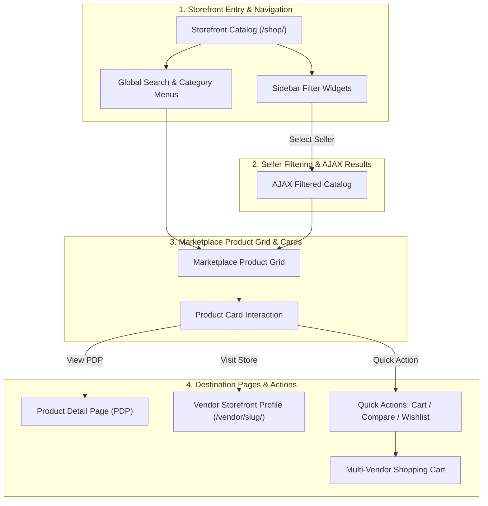

# Product Listing Page (PLP)

The **Product Listing Page (PLP)** (commonly referred to as the **Shop Catalog**) is the central marketplace hub where buyers explore the product catalog, filter items by independent merchants, compare offerings, and discover new sellers in the **[Webkul WooCommerce Multi-Vendor Marketplace](https://store.webkul.com/woocommerce-multivendor-marketplace.html)**.

Unlike a standard single-merchant shop where all catalog items belong to one brand, a multi-vendor marketplace combines products from multiple independent merchants into a unified shopping experience. The PLP gives customers clear visibility into **who sells each item**, provides an **interactive seller list filter**, and offers **direct links to vendor storefronts** before buyers proceed to individual product pages.

---

## Customer Discovery: Navigating the Multi-Vendor Catalog

When buyers arrive on the Product Listing Page, they can explore products and navigate the marketplace through several entry points and controls:

---

## 1. Storefront Discovery & Search Touchpoints

The marketplace storefront provides multiple avenues for customers to discover vendor items before and during catalog browsing:

### 1. Global Header Search Bar
The primary storefront search input includes placeholder text reading *"Search products, brands & vendors…"*. Shoppers can enter product keywords, category names, or specific seller names to immediately query catalog items across all marketplace vendors.

### 2. Header Vendor Lists Dropdown
Located in the primary navigation header:
- **Vendor Lists Menu**: An interactive dropdown menu highlighting featured and active sellers (such as *Aurora Athletics*, *Volt & Vine*, *Maison Terra*, *Lumen Beauty*, and *Copperleaf Kitchen*).
- **Direct Store Links**: Clicking any merchant opens their dedicated storefront, displaying their full brand catalog, bio, and customer ratings.
- **Seller Central Link**: Quick navigation link for prospective vendors to register and start selling.

### 3. Category & Taxonomy Archives
When shoppers select a category (e.g., *Fitness*, *Kitchen & Dining*, *Accessories*), the catalog filters down to that department while preserving multi-vendor seller filtering and attribution.

---

## 2. Sidebar Filter Architecture

The sidebar on the Product Listing Page features purpose-built widgets that enable shoppers to refine their product search by merchant, price, and product attributes:

### 1. Seller List Filter Widget
The **Seller List** widget is the primary marketplace-specific navigation control:
- **Expandable Accordion**: Clicking the **Seller List** header expands or collapses the list of active marketplace merchants.
- **Live Product Counts**: Each vendor entry displays the exact count of listed products available (e.g., *Aurora Athletics (14)*, *Volt & Vine (9)*, *Maison Terra (12)*, *Copperleaf Kitchen (10)*, *Norden Supply (14)*, *Thread & Grain (11)*, *Paperfold Studio (7)*, *Lumen Beauty (6)*).
- **Multi-Vendor Checkboxes**: Customers can select one or more vendors to display only products sold by the chosen merchants.
- **Instant AJAX Filtering**: Product listings update dynamically without a full browser refresh, maintaining the customer's scroll position.

### 2. Reset & Clear Filters
When a seller filter or attribute option is selected, the catalog updates to display the active criteria. Customers can easily uncheck individual vendor boxes or click the clear filter button to restore the complete marketplace catalog.

### 3. Price Range Filter
- Dual slider and direct price input fields (`Min $` and `Max $`).
- Enables customers to define their budget, automatically filtering products across all vendors within that price threshold.

### 4. Attribute Swatches (Colors & Sizes)
- Interactive visual color swatches and size tiles.
- Customers can combine attribute filters with the **Seller List** filter to locate, for example, black fitness accessories sold exclusively by *Aurora Athletics*.

::: tip Combined Filtering Efficiency
Combining the **Seller List** filter with **Price** and **Attribute** filters allows buyers to quickly discover deals from specific merchants without sifting through unrelated listings.
:::

---

## 3. Anatomy of a Multi-Vendor Product Card

Every product card displayed in the catalog grid is tailored to provide clear marketplace attribution and convenient buyer actions:

### Key Product Card Elements:

| Element | Description | Buyer Advantage |
| :--- | :--- | :--- |
| **Vendor Attribution Link** | Labeled as `Vendor: [Vendor Name]` in a prominent blue link directly above the title | Establishes immediate seller transparency; clicking the link navigates to the seller's profile |
| **Discount Badge** | Red badge showing promotional savings (e.g., `-24%` or `Sale!`) | Quick identification of seller promotions and markdowns |
| **Product Image & Hover Effect** | High-resolution product thumbnail with hover zoom or alternate image transition | Visual product preview before clicking through to the PDP |
| **Product Title** | Clean, bold item title linking directly to the full Product Detail Page | Clear identification of item specifications |
| **Transparent Pricing** | Displays regular price struck-through alongside the current discounted price | Accurate price comparison across different marketplace sellers |
| **Add to Cart Quick Action** | Circular action button with cart icon and `Sold By: [Vendor Name]` tooltip | Adds the item to the multi-vendor cart with seller metadata attached |
| **Compare / Wishlist Action** | Quick comparison icon for side-by-side evaluation | Allows buyers to compare similar items across different marketplace vendors |

---

## 4. Catalog Controls, Sorting & Pagination

At the top of the product listing grid, customers have access to catalog controls to organize listings according to their preferences:

### Result Counter
A real-time indicator informs buyers of the catalog volume currently displayed (for example, *Showing 1–12 of 86 results* or *Showing all 9 results* when filtered by a single seller).

### Sorting Options
The sorting dropdown allows customers to rearrange items across all marketplace sellers:

- **Default sorting**: Standard marketplace order set by administrators or vendor priority.
- **Sort by popularity**: Ranks items by sales volume across all merchants.
- **Sort by average rating**: Highlights the highest-rated products based on verified customer feedback.
- **Sort by latest**: Displays the newest additions to the marketplace.
- **Sort by price: low to high**: Ideal for budget-conscious buyers seeking entry-level deals.
- **Sort by price: high to low**: Surfaces premium merchandise first.

### Numeric Pagination Stepper
- Located at the bottom of the catalog.
- Clear numbered buttons (e.g., `1`, `2`, `3`, `4` … `9`) alongside Next (`→`) and Previous (`←`) navigation arrows.
- Allows buyers to browse through large multi-vendor inventories without experiencing page lag.

---

## 5. Transitioning to Vendor Dedicated Storefronts

The Product Listing Page serves as a gateway to dedicated seller shops. Customers have two distinct interaction paths:

1. **Viewing Product Details**: Clicking the **product image** or **product title** takes the customer to the [Product Detail Page (PDP)](https://wpdoc.webkul.com/woocommerce-marketplace/documentation/customer-pdp.html), where they can select variants, read comprehensive specs, and verify customer reviews.
2. **Exploring the Seller's Store**: Clicking the **`Vendor: [Seller Name]`** link bypasses generic listings and opens the merchant's dedicated profile page (`/vendor/[vendor-slug]/`).

### What Buyers Find on a Vendor Storefront:
- **Merchant Store Banner & Avatar**: Professional brand identity and storefront header.
- **Store Collection**: The complete catalog of products offered exclusively by that seller.
- **Seller Ratings & Feedback**: Aggregate review score and individual buyer testimonials.
- **Store Policies & Contact Details**: Shipping guidelines, return/refund terms, and vendor contact options (such as direct contact email, phone number, and physical store address) allowing prospective buyers to inquire about products before purchasing.

::: note Consolidating Orders by Vendor
Purchasing multiple items from the same seller by browsing their dedicated storefront often results in combined shipping, single-package delivery, and simpler tracking.
:::

---

## 6. Mobile Experience & Responsive Filter Drawer

The Product Listing Page is fully responsive, delivering a smooth shopping experience across mobile smartphones and tablets:

### Mobile-Optimized Features:
- **Responsive 2-Column Grid**: Product cards scale naturally on smaller screens while retaining high-resolution imagery and legible typography.
- **Slide-Out Filter Drawer**: On mobile devices, the sidebar collapses into a convenient **Filters** button. Tapping it opens a slide-out drawer containing the complete **Seller List** and attribute swatches.
- **Clear Vendor Attribution**: The `Vendor: [Name]` tag remains clearly visible on mobile cards, preventing accidental cross-vendor confusion.
- **Touch-Friendly Quick Actions**: Large tap targets for cart additions, wishlist saving, and pagination buttons.

---

## 7. Customer Journey Summary on the PLP

| Step | Buyer Action | Marketplace Storefront Feature |
| :--- | :--- | :--- |
| **1. Explore & Search** | Enter search keywords or choose a category | Header search bar with vendor auto-discovery and category menus |
| **2. Filter by Seller** | Expand the *Seller List* widget and check preferred vendors | Interactive checkboxes with live product counts and instant AJAX updates |
| **3. Sort Catalog** | Choose a sort option (e.g., *Price: low to high*, *Average rating*) | Multi-vendor catalog sorting dropdown |
| **4. Inspect Product Cards** | Review vendor badge, price, and promotional discounts | `Vendor: [Seller Name]` attribution and promotional percentage badges |
| **5. Add or Visit Store** | Add directly to cart or click vendor name | Quick add-to-cart button or direct navigation to `/vendor/[slug]/` |
| **6. Browse More** | Navigate through pages or clear filters | Numbered pagination stepper and one-click *Clear Filters* action |
