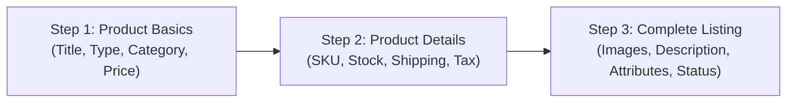

# Site Setting

The **Site Setting** page (`/seller/seller-site-setting/`) allows vendors to personalize their product authoring workflow, selecting between stepper wizards and single-page forms, and adjusting layout modes when enabled by marketplace administrators.

::: tip Personal Workflow Preferences
The options configured on the **Site Setting** screen apply exclusively to your personal vendor dashboard session. Adjusting these settings tailors your product editing workspace to match your preferred data-entry style without altering how products appear to buyers on the live storefront.
:::

---

## Overview of Site Settings

Every merchant manages their product inventory differently. Some sellers prefer a guided step-by-step process that verifies required details before moving forward, while others prefer having all fields visible on one continuous page for fast editing.

The **Site Setting** module provides three primary controls:

1. **Product Stepper**: Toggles a guided 3-stage progress indicator across product creation and editing screens.
2. **Listing Completeness**: Displays an interactive listing health gauge that scores your product content from 0% to 100% and points out missing information.
3. **Form Navigation**: Changes the structural layout of the product editor between **Horizontal Tabs**, **Vertical Tabs**, and a continuous **Stacked Form**.

---

## Administrator Governance (Vendor Mode)

The availability of the **Site Setting** menu depends on marketplace-wide governance set by the store administrator:

- **When Vendor Mode Is Enabled**: Marketplace administrators enable the *Vendor Mode* setting in the central store configuration. As a result, the **Settings > Site Setting** menu appears in your vendor sidebar. Your personal selections override the marketplace default layout for your account.
- **When Vendor Mode Is Disabled**: If the administrator manages product layouts globally, the **Site Setting** menu is hidden from the seller panel. In this scenario, all marketplace vendors share the standardized form layout and stepper mode set by the administrator.

::: note Admin Configuration Reference
Marketplace administrators can configure default form presentations and activate vendor customization under **Marketplace > Settings > Product > Product Form Settings**. For complete administrative instructions, refer to the [Admin Product Settings Guide](https://wpdoc.webkul.com/documentation/product-settings).
:::

---

## Accessing Site Setting

To open and manage your product form preferences:

1. Log in to your **Vendor Account** on the marketplace.
2. In the left-hand navigation sidebar, click the **Settings** menu.
3. Select **Site Setting** from the submenu.
4. You will arrive at the **Site Setting** workspace (`/seller/seller-site-setting/`).

The breadcrumb trail at the top of your screen will confirm your location:  
`Dashboard > Settings > Site Setting`

---

## Configuring Product Form Options

The **Product Form** configuration panel includes three distinct settings. Below is a detailed description of each control and how it influences your workflow.

### 1. Product Stepper

- **Control Type**: Toggle Switch (`On` / `Off`).
- **Default Status**: Enabled.
- **Description**: Displays the guided 3-stage milestone indicator at the top of both the **Add Product** and **Edit Product** screens.

The stepper breaks the listing creation process into three logical milestones:

1. **Step 1: Product Basics** – Enter the product name, select product type (Simple, Variable, Grouped, External), assign categories, and set base pricing.
2. **Step 2: Product Details** – Define inventory SKU, manage stock levels, configure shipping dimensions/weight, and specify tax classes.
3. **Step 3: Complete Listing** – Provide short and long descriptions, upload product and gallery images, assign attributes, configure tags, and set catalog visibility.

::: tip When to Keep the Stepper Enabled
- **Recommended for New Vendors**: The milestone bar ensures no essential sales details (such as weight, SKU, or return policies) are overlooked.
- **When to Disable**: Experienced merchants managing rapid inventory updates often disable the stepper to maximize vertical screen space.
:::

---

### 2. Listing Completeness

- **Control Type**: Toggle Switch (`On` / `Off`).
- **Default Status**: Enabled.
- **Description**: Displays an interactive quality score card and progress bar on the **Edit Product** screen.

The **Listing Completeness** widget acts as a real-time listing assistant:

- **Visual Score Bar**: Displays an exact completion percentage (for example, `35%` or `100%`) alongside a color-coded status bar.
- **Collapsible Checklist (`Missing Details`)**: Clicking the summary reveals an itemized list of unfulfilled elements required for an optimal listing, such as:
  - Short description
  - Primary product image
  - Product image gallery
  - Product tags
  - Regular price
  - Inventory SKU
  - Shipping weight
  - Shipping dimensions
- **Interactive Quick-Jump Links**: Each missing item functions as a direct jump button. Clicking any listed item automatically scrolls the page and focuses your cursor directly into that input field.

::: tip Commercial Benefit of 100% Completeness
Complete product listings achieve higher organic rankings in marketplace searches, provide complete product specifications for search engine rich snippets, and significantly reduce buyer inquiries and return rates.
:::

---

### 3. Form Navigation

- **Control Type**: Dropdown Selection Menu.
- **Options**:
  - `Horizontal Tabs` *(Default)*
  - `Vertical Tabs`
  - `Stacked Form`
- **Description**: Controls how different product configuration sections (such as General, Inventory, Shipping, Attributes, and Variations) are arranged on screen.

Below is an in-depth breakdown of how each layout option behaves in practice.

---

## Product Form Navigation Layouts

Choosing the right navigation mode streamlines your day-to-day listing workflow. You can switch between these three layouts at any time without losing saved product data.

### Option A: Horizontal Tabs (Default)

In **Horizontal Tabs** mode, product sections are organized into a row of horizontal tabs across the top of the editor.

- **Visual Arrangement**: Tabs (`Edit`, `Inventory`, `Shipping`, `Linked Products`, `Attributes`, `Tags & Brand`, `Status`) sit horizontally above the active card. Previous (`<`) and Next (`>`) arrow buttons allow easy scrolling across wide tab lists.
- **Display Behavior**: Only the selected section card is visible at any given moment. Clicking another tab smoothly swaps the visible container.
- **Best Suited For**: Standard widescreen desktop displays and laptops where vertical screen space is precious.

---

### Option B: Vertical Tabs

In **Vertical Tabs** mode, product navigation tabs are arranged into a vertical column on the left side of the product editor.

- **Visual Arrangement**: The navigation menu stays fixed along the left margin, while the active section content occupies the main workspace on the right.
- **Display Behavior**: Clicking a vertical tab instantly loads the corresponding panel in the main content card.
- **Best Suited For**: Ultrawide monitors and desktop workstations where horizontal room is plentiful, providing rapid one-click navigation between deep attribute and variation settings.

---

### Option C: Stacked Form

In **Stacked Form** mode, all tab bars are removed. Every product section is rendered continuously down a single, scrollable page.

- **Visual Arrangement**: All section cards (`Edit`, `Inventory`, `Shipping`, `Status`, `Linked Products`, `Attributes`, `Tags & Brand`, `Variations`) are fully visible and stacked sequentially.
- **Display Behavior**: You can scroll through the entire product definition from top to bottom without clicking tabs.
- **Best Suited For**: Tablet devices, touchscreen monitors, or vendors who prefer reviewing and editing all product parameters in a continuous linear document.

---

### Form Navigation Comparison Matrix

| Feature / Criteria | Horizontal Tabs | Vertical Tabs | Stacked Form |
| :--- | :--- | :--- | :--- |
| **Tab Position** | Top of the form card | Left column beside form | None (Tabs disabled) |
| **Sections Displayed** | Single active section | Single active section | All sections visible |
| **Page Scrolling** | Minimal vertical scrolling | Minimal vertical scrolling | Full-page vertical scroll |
| **Recommended Display** | Standard Laptops / Desktops | Ultrawide / Desktop monitors | Tablets / Touchscreens |
| **Switching Speed** | Quick tab click | Instant one-click jump | Fast mouse-wheel scroll |

---

## Step-by-Step Configuration Guide

Follow these steps to update and verify your product authoring settings:

1. Navigate to **Settings > Site Setting** in your seller panel.
2. To enable or disable the 3-step creation wizard, toggle the **Product stepper** switch.
3. To display or hide the quality progress bar, toggle the **Listing Completeness** switch.
4. Select your preferred layout from the **Form navigation** dropdown (`Horizontal Tabs`, `Vertical Tabs`, or `Stacked Form`).
5. Click the primary **Save Changes** button at the bottom of the form.
6. A confirmation notice will verify that your preferences are updated.
7. Open **Catalog > Products** and click **Edit** on any product to experience your updated layout immediately.

---

## Connecting Site Setting with Catalog Management

Your choice in **Site Setting** works together with the main **Vendor Products** catalog screen (`/seller/vendor-products/`), where you manage existing items and use the advanced filter drawer.

### Using the Slide-Out Filter Drawer

When managing a growing inventory, the product catalog provides an advanced slide-out filter panel to help you pinpoint specific items quickly.

Click the **Filter** button located above the products table to open the filter drawer. You can filter by any combination of the following criteria:

| Filter Field | Input Method | Description |
| :--- | :--- | :--- |
| **Name** | Text Input | Search products by exact or partial product name. |
| **SKU** | Text Input | Search items by Stock Keeping Unit code. |
| **Status** | Dropdown | Filter by publication status (`Draft`, `Waiting for Approval`, `Private`, `Published`). |
| **Is Approved** | Dropdown | Filter by marketplace administrator approval status (`Yes`, `No`, `Rejected`). |
| **Draft Status** | Dropdown | Filter items saved as temporary drafts (`Yes`, `No`). |
| **Type** | Dropdown | Filter by WooCommerce product type (`Simple product`, `Grouped product`, `External/Affiliate product`, `Variable product`). |
| **Category** | Dropdown | Filter by assigned product categories (e.g., Clothing, Accessories, Decor). |
| **Price (Min / Max)** | Dual Numeric Inputs | Specify a minimum and maximum retail price threshold. |
| **Product Number** | Text Input | Search by variation-specific SKU or vendor reference number. |
| **ID** | Numeric Input | Filter directly by the system product identification number. |
| **Barcode Value** | Text Input | Search by GTIN, UPC, EAN, or ISBN barcode number. |

After configuring your desired criteria, click **Apply Filters**. To reset your view and display the full catalog again, click **Clear all**.

::: tip Sorting & Bulk Actions
- **Sort By**: In addition to filters, you can use the **Sort By** dropdown on the catalog bar to sort products by *Price - Low to high*, *Price - High to low*, or *Newest First*.
- **Bulk Operations**: Select multiple filtered products using the table checkboxes to apply bulk actions such as *Delete*, *Assign Categories*, *Publish*, or *Generate/Print Barcodes*.
:::

---

## Frequently Asked Questions (FAQ)

### Why can't I see "Site Setting" under the Settings menu?
If **Site Setting** is missing from your sidebar, the marketplace administrator has not enabled **Vendor Mode** in the global marketplace settings. When Vendor Mode is disabled, all vendors automatically inherit the administrator's default form layout. You can contact marketplace support or your platform administrator to request access.

### Does changing my form layout affect existing products?
No. Form navigation layouts only change how information is organized on your editing screen. Switching between Horizontal Tabs, Vertical Tabs, and Stacked Form will never alter, overwrite, or delete your product descriptions, pricing, images, or inventory data.

### Can I hide the Listing Completeness score if I don't need it?
Yes. Simply toggle the **Listing Completeness** switch to `Off` in **Site Setting** and click **Save Changes**. The score gauge and missing details checklist will be removed from your product edit screens.

### Does disabling the Product Stepper prevent me from publishing products?
No. Disabling the stepper simply removes the 3-step milestone bar from the top of the editor. All required product fields remain accessible and fully functional on the form.

### Which layout is best for mobile or tablet editing?
If you frequently manage products on tablets or touch devices, the **Stacked Form** layout is recommended because it allows smooth vertical finger scrolling without needing to tap small navigation tabs.

---

## Related Documentation

- [Vendor Product Management](https://wpdoc.webkul.com/documentation/vendor-product-management) – Complete guide to creating, editing, and publishing marketplace products.
- [Vendor General Setting](https://wpdoc.webkul.com/documentation/vendor-general-setting) – Manage personal account profiles, email addresses, and passwords.
- [Vendor Graph Setting](https://wpdoc.webkul.com/documentation/vendor-graph-setting) – Customize chart color schemes across vendor reporting dashboards.
- [Admin Product Settings](https://wpdoc.webkul.com/documentation/product-settings) – Configure platform-wide product defaults and enable Vendor Mode.
- [Product Barcode Management](https://wpdoc.webkul.com/documentation/product-barcode) – Generate and print Code 128, UPC-A, and EAN-13 barcodes.
